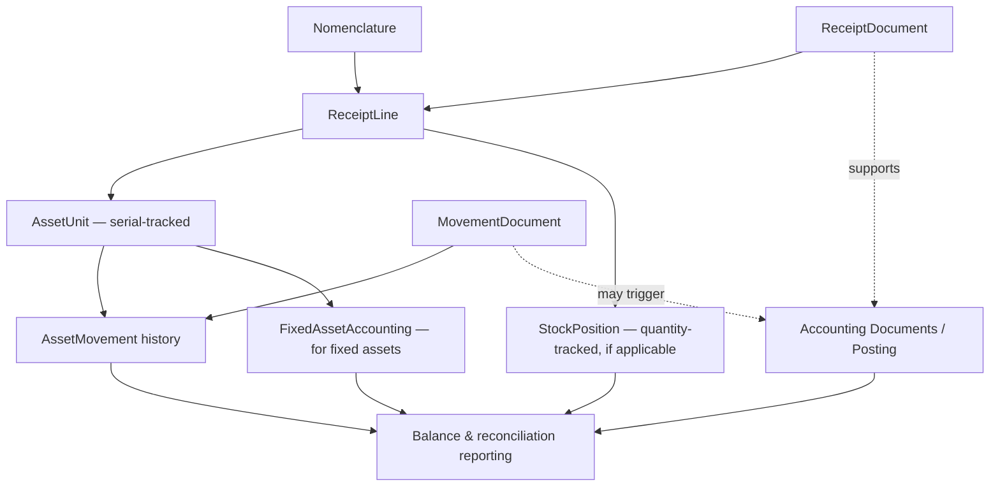

# MAAS-UA — Domain Model (Working Draft)

**Status:** Working draft, based on architecture discussions; not a complete or legally validated accounting specification.  
**Scope:** Military material assets, initially FPV drones, reusable unmanned aircraft complexes (БпАК), replacement parts and accessories.  
**Goal:** Support individually traceable and quantity-based accounting, monetary reconciliation and document-backed historical reporting.  
**Language:** English for code-oriented documentation; retain Ukrainian accounting terms where precision matters.

## 1. Why this system exists

The primary business question is:

> As of a selected reporting date, which concrete items, quantities and monetary values make up each accounting balance; where are they, who is responsible, how were they received, what happened to them, and which documents support each change?

The application should allow drill-down from total value by subaccount / funding program / КЕКВ (КЕКВ, code of economic expenditure classification) / source of receipt, to nomenclature, physical unit or quantity-tracked stock, and ultimately to historical operations and supporting documents.

Two related but distinct ledgers must be reconciled:

- **Property / custody accounting:** identities, quantities, technical/operational condition, custody, location, physical movement, write-off.
- **Financial accounting:** recognition, account/subaccount, amount, acquisition and carrying values, depreciation, economic classifications, accounting documents and postings.

A physical transfer may have no change in overall carrying value; depreciation may change carrying value without moving an item. Do not conflate these processes.

## 2. Confirmed facts and decisions

The following reflect the current conversation and are suitable as **modeling requirements**, subject to validation against approved documents and applicable regulations:

1. The initial area is UAV-related property managed by an aviation / air-defense property service.
2. Reusable БпАК are accounted for as **fixed assets** with depreciation. FPV drones, spare parts and components are accounted for as **inventory / supplies**. Classification rules for specific items require validation.
3. Both FPV drones and reusable БпАК are tracked **per physical unit by a serial number**.
4. A supplier may provide the serial number. If absent, authorized property-accounting personnel assign an internal serial number, possibly using an organizational prefix and an incrementing suffix.
5. Receipt source can vary: centralized procurement / supply, defense procurement agency, charitable assistance, transfer from another military unit, etc.
6. A single incoming document (invoice or acceptance-transfer act) can contain a homogeneous line of FPV drones. **Every unit in that homogeneous line has an identical accounting unit cost.**
7. Transfers and write-offs identify specific units by serial number. The historical identity and original receipt must remain recoverable.
8. Reporting must show quantity, acquisition and (where applicable) residual value, account analytics, acquisition source, current condition, custody and location, and documentation of movements/write-offs.
9. Some spare parts and small consumables may not need serial-level tracking; the policy is not yet confirmed per nomenclature.

## 3. Domain vocabulary

| Term | Meaning | Modeling role |
|---|---|---|
| `Nomenclature` | Catalog definition of a type/model of property, e.g. a particular FPV drone or antenna | Reference entity |
| `ReceiptDocument` | One receipt-supporting document (invoice / acceptance-transfer act) | Candidate aggregate root |
| `ReceiptLine` | A homogeneous line in a receipt: nomenclature, quantity, identical unit cost, relevant provenance/analytics | Entity inside receipt aggregate; initial origin grouping |
| `AssetUnit` | A single physical object with individual identification, such as one FPV drone or БпАК | Candidate aggregate root |
| `SerialNumber` | Supplier-issued or internally assigned identifier used by the service to identify a physical unit | Business identifier / possible value object |
| `MovementDocument` | Document authorizing and recording transfer, issuance, return, or other movement | Candidate aggregate root |
| `AssetMovement` | Dated historical record of one unit's movement/change in custody or status | Historical fact tied to a document |
| `StockPosition` | Quantity and monetary valuation for inventory that is not serialized, broken down by required dimensions | Domain projection or aggregate to be determined |
| `FixedAssetAccounting` | Specific financial attributes of an individually tracked fixed asset | Separate accounting model; boundary TBD |
| `AccountingDocument`, `JournalEntry`, `PostingLine` | Financial-document and posting concepts | Separate accounting aggregate(s), TBD |
| `AccountingDimensions` | Subaccount, program, КЕКВ, acquisition source, other analytical codes | Referenced codes/dimensions, often effective at operation time |
| `Money`, `Quantity`, `DocumentReference`, `AccountingPeriod` | Immutable meaningful values with validation | Value objects |

`ReceiptLine` provisionally replaces an additional `InventoryLot` entity for the first use case: it already represents the homogeneous origin group and price. Introduce a distinct lot only if a real scenario requires lot identity or life cycle independent of the receipt line.

## 4. Conceptual relationship model



Relationships express intent, **not final table cardinalities, lifecycle ownership, or aggregate boundaries**. The domain must support a receipt with multiple lines. A line may be serial-tracked or quantity-tracked depending on the nomenclature policy.

### Why no PostgreSQL array of serial numbers?

A list/JSON array on a receipt might look simple, but makes per-unit uniqueness, custody, transfers, concurrency, write-off history and audit queries unnecessarily difficult. A serial-tracked unit needs its own persistent identity and relationship to its immutable receipt origin. **Moving or writing off a unit never removes it from the original receipt.**

## 5. Tracking modes

### 5.1 Serial-tracked property

Examples: FPV drones and reusable БпАК.

- Store **one `AssetUnit` per physical unit**.
- Use internal immutable ID (UUID or comparable surrogate key); *do not* use serial number as the database PK.
- Store serial number with issuer/namespace or origin information sufficient to apply an agreed uniqueness rule.
- Keep link to original `ReceiptLine`, which carries original accounting unit price and provenance.
- Track movements and lifecycle history via referenced, dated, document-backed records.
- Preserve written-off units in queries and audit history.

### 5.2 Quantity-tracked property

Examples potentially include non-serialized cables, connectors and minor spare parts.

- Track by nomenclature, source/origin grouping, valuation, location, custody and necessary accounting analytics.
- Manage quantities through dated receipt/issue/transfer/write-off movements, not by overwriting a historical initial quantity.
- Define valuation for issues across differing receipt prices *before* implementing fungible stock allocation (specific identification, FIFO, weighted average, or another officially approved method). **No method is approved yet.**
- Support units of measure and avoid combining incompatible units.

A nomenclature item should have an explicit **tracking policy** (`SERIALIZED` or `QUANTITY`) where approved. Do not assume all components are individually tracked merely because drones are.

## 6. Receipt model and example

**Illustrative synthetic scenario** — one document receives 27 identical FPV drones of nomenclature “Kolibri”; 27 unique serial identifiers; one accounting unit price.

```text
ReceiptDocument
  document_number: EXAMPLE-125
  document_date: 2026-01-15
  source: CHARITABLE_ASSISTANCE [illustrative]
  lines:
    - ReceiptLine
        nomenclature: FPV_KOLIBRI
        quantity: 27 pcs
        unit_price: UAH 14_500.00
        line_total: UAH 391_500.00
        asset_units:
          - AssetUnit(id=..., serial=EXAMPLE-FPV-0001)
          - AssetUnit(id=..., serial=EXAMPLE-FPV-0002)
          - ... 25 more
```

These labels, amounts, dates and serials are **synthetic** and are not real unit records.

### Candidate receipt invariants

- Quantity must be positive and compatible with nomenclature tracking policy.
- For a serialized line, number of distinct registered units must equal the line quantity **at posting**, subject to any approved exception workflow.
- An individually tracked physical unit has one immutable internal ID and one original receipt link.
- Duplicate serial identifiers within the receipt's applicable uniqueness namespace are rejected.
- `line_total = quantity × unit_price` under an explicit currency/rounding rule for this homogeneous-price scenario.
- A posted receipt cannot be silently edited to erase original quantity/price/provenance. Corrections require a defined, auditable amendment or reversal workflow.
- On failed posting, no partial units/receipt are committed.

**Not yet decided:** whether draft receipts may be stored partially before all serial numbers are captured; allowed correction/reversal workflow; when and how postings are generated. Section 17 records the confirmed serial uniqueness rule for the implemented receipt slice; actual namespace assignment remains unresolved.

## 7. Identity and serial numbering

Because some supplier serials may be absent and internally assigned numbers include prefixes, use a dedicated serial-number allocation/validation policy.

Recommended split:

- `AssetUnit.id`: system identity; immutable.
- `AssetUnit.serial_number`: human/business lookup key.
- `serial_origin`: `MANUFACTURER` / `SUPPLIER` / `INTERNAL` or another confirmed classification.
- `serial_namespace` / `issuer`: only if needed for correct uniqueness and disambiguation.

For the implemented receipt slice, uniqueness is the exact, case-sensitive pair of caller-supplied namespace and serial text, without normalization (see section 17). Supplier serials are not assumed globally unique. **Open issue:** how actual supplier/manufacturer/internal namespaces are assigned and authorized. An internal sequence may require PostgreSQL-controlled allocation to avoid concurrent duplicates. Enforce the confirmed uniqueness rule in the database as well as validating it in domain/services.

Documented serial corrections should preserve an audit trail; do not silently reuse identities.

## 8. State is multidimensional

Avoid one catch-all `AssetStatus` enum. Distinguish at least:

| Dimension | Questions answered | Examples (not approved enum values) |
|---|---|---|
| Accounting classification | What kind of accounting item? | Fixed asset / inventory |
| Recognition | Where is value recognized? | On-balance / off-balance |
| Condition | In what technical condition? | Serviceable / needs repair |
| Operational/lifecycle state | Is it stored, issued, repaired, written off? | Storage / in use / repair / disposed |
| Location | Where is it held? | Warehouse / organizational unit |
| Custody | Who is responsible? | Custodian / responsible person |
| Origin | How did the item arrive? | Central supply / donation / transfer |
| Accounting dimensions | How is its value categorized? | Subaccount, program, КЕКВ |

Some dimensions are **time-dependent accounting attributes of operations**, not intrinsic or permanently mutable properties of the physical unit. For an as-of report, reconstruct or query the state at that date. Decide whether current state is a materialized projection maintained transactionally or derived from movement history; retain source-of-truth records either way.

## 9. Different accounting treatments

### Inventory (including FPV drones)

- Acquisition/receipt establishes initial valuation and provenance.
- Serial-tracked FPV drones remain individually identifiable through issuance, transfer, and eventual write-off.
- Inventory issue, physical use, and accounting write-off are **separate concepts** until official rules establish when they coincide.
- Quantity-tracked stock uses a distinct balance/movement mechanism.

### Fixed assets (reusable БпАК)

- Individually identified `AssetUnit`, associated fixed-asset-specific accounting data.
- Initial cost, depreciation policy, accumulated depreciation, carrying/residual amount and reporting periods.
- Depreciation changes financial carrying values, **not** physical location.
- Do not assume depreciation parameters or journal mappings until validated.

A single common `AssetUnit` identity with separate `FixedAssetAccounting` behavior avoids two unrelated identity schemes. Avoid placing all accounting fields as nullable attributes on every unit.

## 10. Documents, history and auditability

- Receipt, movement, issuance, return, repair, write-off, adjustment and financial posting should be distinguishable operations as business rules emerge.
- Every committed movement or write-off must reference an appropriate document/authorization under approved procedure.
- Store meaningful dates (document date, effective date, timestamp entered), user identity where permitted, references, and justifications for corrections.
- Preserve source and historic ownership/custody; don't overwrite history when current owner/location changes.
- Posted journal entries and approved documents should use an auditable correction/reversal process; exact requirements remain to be determined.
- Design audit output around reconstructable evidence, not only a current `status` column.

## 11. Aggregates and transactions — provisional

- **ReceiptDocument** is a plausible aggregate root governing its `ReceiptLine` children, totals and posting eligibility.
- **AssetUnit** is a plausible aggregate root governing one serialized unit's valid lifecycle transitions, while linking to origin and histories.
- **MovementDocument** governs its list of referenced units and supporting rationale; exact ownership of movement records to be tested on real scenarios.
- Financial posting has its own integrity boundary; journal-entry lines should balance according to verified rules.
- An application service with a **Unit of Work** coordinates a receipt posting that creates a document and 27 asset units in one database transaction.

Avoid loading entire receipt batches to change one drone. Avoid designing aggregate boundaries solely from SQL foreign keys. A single transaction may persist multiple aggregates when required to maintain a documented cross-aggregate invariant.

## 12. Reporting and reconciliation requirements

At a given date, users must be able to:

1. Explain a financial total by subaccount, program, КЕКВ, source, nomenclature and document.
2. Identify exact serialized physical units contributing to a quantity/monetary balance.
3. Find a unit by serial number and see its origin, price, lifecycle events, custody/location history, depreciation (if applicable), and write-off reference.
4. Show non-serialized stock quantities and values by required analytics.
5. Reconcile property-service balances to finance-service balances and explain discrepancies.
6. Produce reports without losing the historical context when a unit has moved or been written off.

Do not confuse a receipt's **original quantity** with its **remaining current stock**. Be explicit about document-effective dates, late postings, accounting periods, and any snapshots used for performance.

## 13. First TDD vertical slice: `RegisterInventoryReceipt`

**Input:** confirmed receipt document and one serialized homogeneous line; nomenclature; quantity; unit price; synthetic serial identifiers; applicable receipt source and analytics.

**Expected output:** accepted receipt and 27 independently identified `AssetUnit` records linked to its original line, or a clear domain/application failure with no partial persistence.

### Suggested domain tests

```python
# Behavior sketches: names/API are provisional.
def test_serialized_receipt_requires_one_serial_per_unit(): ...
def test_serialized_receipt_rejects_duplicate_serials_in_scope(): ...
def test_receipt_line_total_uses_decimal_math(): ...
def test_registered_unit_retains_original_receipt_link(): ...
def test_original_receipt_remains_unchanged_after_transfer(): ...
```

### Suggested service tests

```python
def test_register_receipt_persists_document_and_units_using_fake_uow(): ...
def test_register_receipt_does_not_commit_when_domain_validation_fails(): ...
```

### Integration tests (isolated PostgreSQL)

- SQLAlchemy mapping of receipt, lines and units.
- Unique constraint / concurrency handling under the approved serial-namespace rule.
- Atomic rollback when a unit conflicts or database write fails.
- Alembic migration creates expected constraints.

### E2E / Excel tests

A few representative Flask/upload/report workflows using synthetic files. Preserve existing generation behavior where present. Do not assert binary identity of XLSX files.

## 14. Key unresolved business decisions

Before irreversible schema or accounting rules are implemented, confirm:

1. **Serial namespace assignment:** supplier/manufacturer overlap, authorization of caller-supplied namespaces, internally generated-number allocation, and correction of wrong numbers. Exact pair comparison is confirmed for the receipt slice (section 17).
2. **Receipt lifecycle:** draft vs posted; whether partial serial capture is permitted; cancellation/amendment workflows.
3. **Non-serialized stock:** exact nomenclature categories; valuation method and cost allocation for issues across differently priced receipts.
4. **Accounting source of truth:** which source system owns balances, postings, and official account mapping; reconciliation workflow.
5. **Accounting dimensions:** where program, КЕКВ, funding source, account and subaccount attach (receipt, unit, movement, posting) and whether they can change by reclassification.
6. **Movement events:** permitted transitions, custody acceptance, issue vs consumption vs write-off, document requirements, dates.
7. **Fixed asset depreciation:** commencement, useful life, method, rounding, historical adjustments and disposal.
8. **As-of queries:** rules for backdated/late-arriving documents and closed periods.
9. **Correcting history:** reversal, reclassification, and audit requirements.
10. **Access control:** roles, allowed actions and legally permitted data handling.

Do not replace these questions with assumptions based on generic commercial inventory systems.

## 15. Implementation principles

- Start from confirmed business scenarios and tests, then choose aggregate boundaries and persistence mapping.
- Prefer immutable historical facts and explicit domain commands over direct ORM field updates.
- Build a test pyramid: most tests in pure domain, some service tests with fakes, focused PostgreSQL integration, minimal E2E.
- Use Flask as an entrypoint, not the location of accounting rules.
- Use SQLAlchemy as an adapter, not a dependency of the domain.
- Keep Excel imports/exports in adapters; they must not define the domain model.
- Avoid unnecessary microservices, event sourcing, over-generalized repositories or a full abstraction layer for every reference table.
- Any illustrative amounts, codes, documents and identifiers in this file are **not authoritative accounting guidance**.

## 16. Security

This repository may eventually handle sensitive property and financial records. Use **only synthetic data** for prompts, automated tests and committed examples. Do not expose actual service members, organizational identifiers, serial numbers, inventory locations, documents, operational information, database exports or spreadsheets to AI tools unless expressly authorized by applicable procedures. Protect secrets and separate test/dev/production environments.

## 17. Confirmed Milestone 2 receipt persistence decisions

Confirmed by the user on 2026-10-30 for the existing receipt-registration slice:

- Serial uniqueness is the exact, case-sensitive `(namespace, value)` pair, with the namespace supplied explicitly by the caller. No normalization or global serial uniqueness is introduced.
- Monetary amounts remain finite, nonnegative `Decimal` values, including zero, without added rounding or currency quantization. PostgreSQL stores the unit acquisition price as unconstrained `NUMERIC`; the line total remains derived from price and quantity.
- Document numbers are not unique identifiers. UUID identities are unique; repeating a document number with distinct units is permitted. Re-registering existing serials is rejected atomically.

These decisions carry Milestone 1 behavior into persistence. They do not define financial postings, regulatory valuation/rounding policy, namespace allocation, drafts, corrections, or document-number deduplication beyond this slice. Implementation and test setup are documented in [PostgreSQL receipt persistence](../development/postgresql-receipts.md).

## 18. Milestone 2.1 — persistent nomenclature

`Nomenclature` is immutable reference data with an existing opaque text ID, a
separate stable internal code, name, unit of measure, explicit tracking policy,
and optional default accounting classification. Classification is a caller-supplied
reference, not an invented chart of accounts; unknown classifications remain unset.
Funding, program, КЕКВ and balances are not catalog identity fields. Codes compare
exactly and case-sensitively and are unique in PostgreSQL. Catalog creation and
retrieval use the existing UoW; no catalog edit/delete workflow is provided.

`ReceiptLine` retains its nomenclature reference and receipt-time tracking policy;
a foreign key enforces catalog existence. Registration checks the supplied catalog
snapshot against the persistent record and requires matching units of measure.
Receipts and acquisition prices remain immutable. Catalog IDs are retained as text
to avoid rewriting historical references or introducing a second identity scheme.

For an existing database, upgrade to `0002`, populate the catalog with reviewed
metadata using the **existing** receipt nomenclature IDs, then upgrade to `0003`.
The reference migration refuses absent or incompatible catalog entries; it never
synthesizes names, codes, units, or replacement IDs. A fresh empty database can
upgrade directly to head. These migrations have only been exercised on disposable
test databases; applying them to shared databases remains an operator action.

## 19. Milestone 3 — documented custody transfers

Initial rules confirmed by the user on 2026-11-01:

- Receipt registration may supply an initial `CustodyAssignment` with opaque
  location and responsible-party references. New receipt units are `ACTIVE`.
  Unknown custody is represented explicitly by `None`, not a fictional warehouse.
- Only units with explicitly `ACTIVE` lifecycle state and a matching known source
  assignment can transfer. Unknown lifecycle is ineligible. M5A adds the terminal
  `WRITTEN_OFF` state and transition described in section 21.
- Movement identity is a caller-supplied UUID reused on retries. Duplicate UUIDs
  are rejected; document numbers alone do not identify duplicates or imply legality.
- A transfer's effective date must be on or after the selected units' receipt and
  latest transfer dates. Same-day transfers are allowed. Chronology is checked per
  selected unit; unrelated units need not have the same latest effective date.

`AssetUnit` remains a separate aggregate with immutable identity, serial and receipt
line link, plus current custody, lifecycle state, and last effective date. Acquisition
price, nomenclature, receipt origin and analytics remain on the original receipt
line/document. A transfer returns replacement immutable unit snapshots; it does not
edit the receipt, change lifecycle, or create financial entries.

`MovementDocument` is an immutable aggregate with UUID, document number/date,
effective date, aware creation timestamp, historical source and destination
assignments, and a nonempty ordered tuple of `MovementLine` unit references. Each
unit appears exactly once. Since all units share source/destination in this command,
those assignments are stored once on the document rather than repeated per line.
Line identity is the `(movement_id, asset_unit_id)` pair; foreign keys preserve
references to existing units. No movement update/delete operation is provided.

The domain validates the complete selection before creating changed snapshots:
all requested units exist; IDs are distinct; assignments differ; every unit is
eligible, at the source, and within the allowed effective-date order. The service
loads only selected units and uses one UoW to insert history and save current
custody, followed by one explicit commit. Failed validation or persistence rolls
back all units and the movement. Receipt provenance and acquisition values remain
unchanged. Serial-number resolution is left to a future entrypoint; this command
accepts internal UUIDs only.

PostgreSQL locks selected asset rows with `SELECT ... FOR UPDATE` in UUID order
until transaction completion. Reads refresh snapshots after any lock wait, so a
competing transfer validates the committed custody/date. The service rechecks the
movement UUID after waiting; a PK constraint also handles races on disjoint units.
Lock timeouts, deadlocks and serialization failures become `RepositoryConflict`;
callers must retry the complete command rather than individual writes. Fakes use
immutable snapshots and reject stale commits rather than simulating row locks.

Migration `0004` adds current custody/lifecycle/date fields and movement tables.
Existing units receive their known receipt effective date but retain unknown
custody and lifecycle; they cannot transfer until a separately approved onboarding
operation establishes those facts. No such history-repair workflow is implemented.

Scope exclusions and remaining questions:

- Backdated transfers preceding a unit's current effective date, reversals,
  corrections, closed periods and history editing are unsupported. Approved
  correction rules must precede an implementation; do not bypass date validation.
- No posting, depreciation, write-off, quantity-stock movement or Flask interface.
- No legal document validation, custody acceptance/authorization, HR hierarchy or
  location catalog. References are opaque; their authoritative source is unresolved.
- Legacy onboarding and serial-resolution UX remain future work. Section 20
  defines the reporting queries; section 21 extends their lifecycle support.

## 20. Milestone 4 — historical inventory and acquisition valuation

Approved by the user on 2026-11-02 and implemented as a read-side vertical slice.

### Initial facts and movement order

New receipt units record immutable `initial_custody` independently of mutable
current custody. Transfers preserve it, and both fake and SQL repositories reject
attempts to change it through `save`. A missing assignment remains `None`.
Application immutability follows the same supported-API boundary as receipt origin;
it does not protect against unrestricted administrative database writes.

Migration `0005` adds the nullable initial location/party pair and nullable
`movement_documents.registration_order`. It preserves every existing business
field and leaves new fields NULL on legacy rows. It never infers initial custody
from current custody or a movement source and never assigns legacy order by
timestamps or UUIDs. Downgrade refuses to destroy these historical facts.

New movement order comes from a PostgreSQL sequence default at INSERT. The
transfer command already holds all selected asset locks in UUID order before
staging/inserting its movement; waiting transactions allocate nothing while
blocked on those locks. For a shared asset, the predecessor releases its locks
only after commit/rollback, so successful same-day successors have larger orders.
Concurrent tests verify lock waiting and persisted order across sessions.
Sequence gaps after rollback are legitimate. Order is storage metadata rather
than a new domain identity; it does not order unrelated business dates or prove
global commit order. Direct inserts bypassing the transfer command do not have
this chronological guarantee. Per-asset nondecreasing effective dates remain
required, and same-day transfers remain allowed.

### Date semantics and supported lifecycle

`as_of` is a Python `date`, with inclusive end-of-day business semantics:
receipt and transfer `effective_date <= as_of`. Datetimes and invalid date inputs
are rejected. Document dates and aware `created_at` are evidence only. A later
registration of a past-effective document may change an earlier report. There
is no bitemporal cutoff, closed-period rule or new restriction on future dates.
Positions before a known receipt date return `registered=False`, distinct from a
missing unit (`AssetNotFound`) and registered units with unknown custody.

All persisted receipts/movements represent completed commands. There are no
draft/cancel flags, reversals, corrections or mutation workflows in M4. `ACTIVE`
was the only supported lifecycle in M4, and transfers never change it. Unknown
legacy lifecycle makes a balance incomplete. Section 21 adds dated write-off
history and historical lifecycle reconstruction; current lifecycle alone never
substitutes for that history.

### Queries, scope and completeness

Frozen query/result dataclasses and the small `InventoryReader` protocol live in
`service_layer/inventory.py`. Handlers delegate without a command UoW. Core SELECTs
in `adapters/inventory.py` implement all five operations:

- `GetAssetBySerialNumber` uses the exact `(namespace, value)` key. Missing scope
  is invalid; no match is `AssetNotFound`; a contradictory multiple match is an
  explicit integrity error. Known provenance survives incomplete custody/history.
- `GetAssetHistory` returns receipt and movement documents grouped by effective
  day, with document dates, registration times and source/destination assignments.
  Receipt precedes transfers on its day; proven transfer order uses the sequence.
  Multiple same-day transfers with missing order set `HistoryDay.ordered=False`
  and an ambiguity issue. Their presentation tuple is not asserted chronological.
- `GetAssetPositionAsOf` reconstructs from initial custody and eligible movement
  destinations, never current custody. It exposes registration and completeness
  separately, checks custody continuity and rejects a movement before receipt as
  an explicit issue. Ambiguous order exposes no chosen destination.
- `GetInventoryBalance` and `GetInventoryValuation` reuse that SQL position
  component. They count asset identities, not the original receipt quantity, and
  aggregate with PostgreSQL COUNT/SUM, without loading domain aggregates.

Every inventory group retains receipt/line provenance, nomenclature, source,
unit acquisition price/currency, units of measure and stored receipt analytics.
`group_by` optionally splits by location and/or custodian. Omitting either custody
axis combines it within the same origin; NULL in such a group means an omitted
grouping axis, not an invented custodian. Catalog classification defaults are
never interpreted as historical accounting analytics.

Filters support nomenclature, receipt, source, currency, receipt analytic pairs,
historical location and responsible party. Static origin filters narrow the
candidate set before completeness checks. Known positions outside a custody
filter do not fail an unrelated report. Unresolved positions might match, so they
remain in diagnostic scope rather than being silently omitted. Candidate counts
and known acquisition values can therefore include possible matches and must not
be interpreted as verified filtered balances.

Incomplete provenance, initial custody/lifecycle, ambiguous order, broken custody
chains or pre-receipt movements yield explicit issue codes. Incomplete reports
return no groups, retain grouped diagnostic quantities/known monetary values, and
raise `IncompleteInventory` on access to verified `count`/`totals`. Empty valid
reports have count zero, empty groups and no currency totals. Lookup/history and
position may return available facts with `complete=False`. Invalid stored analytic
structures raise an explicit reporting-data error rather than inventing values.

### Valuation, snapshot consistency and performance

Acquisition value is the sum of original receipt-line unit prices for selected
units. PostgreSQL unconstrained NUMERIC and Decimal preserve the existing exact
precision policy; no currency quantization or FX conversion is introduced. Currency
totals remain separate. Transfers conserve unit counts and acquisition value;
these reports are not depreciation-adjusted carrying values or financial ledgers.

Each reader call opens its own REPEATABLE READ, READ ONLY PostgreSQL transaction.
All related SELECTs see the same snapshot; connection close rolls back, with no
commit, autoflush or command-session reuse. Reports use three set-based SELECTs
(diagnostics, currency totals, origin/custody groups), independent of asset count.
The synthetic scale test checks query count and EXPLAIN ANALYZE/BUFFERS on 5,000
assets with 2,750 movement lines. Existing FK/serial indexes and the new unique
order constraint suffice for that measured plan; no speculative reporting index
or materialized projection is added. This is not a production capacity guarantee.


## 21. Milestone 5A — documented serialized-inventory write-off

Business semantics confirmed by the user on 2026-11-03 and implemented in M5A.

### Accounting acceptance and date semantics

A serialized FPV drone remains in accounting inventory after transfer to a subdivision
and after physical use or loss. The subdivision supplies the required supporting
package, including the properly authorized write-off document. The financial-economic
service examines the package and accepts it for accounting when complete and valid.

**The write-off accounting effective date is the date when the financial-economic
service accepts the verified document package for accounting.** Initial receipt of
unverified documents does not establish that date.

- `document_date`: date of the write-off act.
- `authorization_date`: date of the commander's authorization.
- `effective_date`: explicit date of financial-economic acceptance for accounting.
- `created_at`: timezone-aware system registration timestamp supplied by the service clock.

The service requires `effective_date` explicitly and never derives it from the act,
authorization, transfer, launch/loss, first receipt of documents, or registration time.
It must be on or after authorization, the asset's receipt effective date, and its latest
transfer effective date. Each selected unit is checked independently. Same-day receipt,
transfers and subsequent write-off are permitted. No further act-date relationship,
closed-period rule, future-date restriction or bitemporal registration cutoff is added.
Late registration can therefore change an earlier effective-date report.

### Persisted classification and eligibility

`ReceiptLine.accounting_classification` is an immutable receipt-time snapshot:
`AccountingClassification.INVENTORY`, `FIXED_ASSET`, or `None` (unknown). It is
separate from tracking policy, recognition, lifecycle, catalog defaults and ledger
analytics. Receipt registration accepts it explicitly, without changing existing
callers that omit it. A homogeneous receipt line has one classification for its units.

M5A requires the persisted classification to be `INVENTORY`, receipt tracking to be
`SERIALIZED`, and unit lifecycle to be explicitly `ACTIVE`. Fixed assets and unknown
classification/lifecycle are rejected. No configured identifier allowlist, name/code
heuristic, or inference from `default_accounting_classification` is used. The migration
leaves legacy classifications NULL, including records with suggestive catalog defaults.
No history-repair or legacy classification backfill operation is supplied.

### Documents, immutable history and transaction boundary

`WriteOffDocument` is an immutable aggregate with caller-supplied UUID, act number/date,
nonblank authorization reference/date, accounting effective date, aware registration
timestamp, and a nonempty ordered tuple of `WriteOffLine` asset UUID references.
Line identity is `(write_off_id, asset_unit_id)`. The document accepts units across
receipt lines and custodians; write-off does not require or invent a custody transfer.

The document UUID is reused on retries. An existing UUID raises `DuplicateWriteOff`;
there is no silent success/idempotent replay. Document numbers are nonunique, as in M3.
Different UUIDs are distinct registrations; the same unit cannot belong to two write-offs.
The policy does not detect duplicate paper documents assigned different UUIDs selecting
disjoint assets. A paper-document deduplication namespace needs separate business rules.

`WriteOffAssets` validates distinct UUIDs, existence, immutable receipt classification,
receipt/latest movement chronology and any previous write-off. It rejects inconsistent
current effective-date metadata. All validation precedes changed snapshots or staging.
It returns replacement units with `WRITTEN_OFF` lifecycle and the accounting effective
date as `last_effective_date`. Serial identity, initial/current custody, original receipt
and price, analytics and every movement remain unchanged and searchable. Custody after
write-off is the last recorded assignment, not proof of physical possession.

One UoW locks selected asset rows in UUID order using the same repository operation as
transfers, refreshes after waiting, rechecks document identity, reads origin/history facts,
stages the document and all changed units, and commits once. PostgreSQL document PKs and
unique write-off membership per unit defend identity races. Failures roll back the entire
transaction. Lock timeouts, deadlocks and serialization failures retain the existing
`RepositoryConflict` whole-command retry contract. A waiting transfer observes written-off
lifecycle and fails; a waiting write-off observes a newly committed transfer and revalidates
its effective date. Fakes preserve the atomic snapshot/stale-commit behavior.

There are no document update/delete operations, unit deletion, implicit launch/loss events,
or changes to the receipt's original quantity. This is application/API immutability with
FK/uniqueness constraints, not protection against unrestricted administrative database writes.

### Historical membership, custody and acquisition value

Core read queries reconstruct accounting lifecycle from receipt and dated write-off facts.
A consistent written-off unit is `ACTIVE` before accounting acceptance and `WRITTEN_OFF`
on and after that date, inclusive. Current lifecycle is cross-checked against history;
it never acts as the sole historical membership criterion. Before receipt, positions
retain `registered=False`. Historical custody still comes from initial assignments and
movement destinations, independently of lifecycle.

Inventory filters default to `LifecycleState.ACTIVE`. `WRITTEN_OFF` requests the written-off
population; `None` includes both with separate lifecycle groups. Unknown/contradictory
lifecycle history remains diagnostic in either selection. Missing write-off evidence,
contradictory current state/classification, write-off preceding receipt/authorization,
or movements dated after write-off produce `invalid_write_off_history`. M4 missing-origin,
unknown-custody, broken-chain and ambiguous same-day transfer diagnostics remain supported;
incomplete reports suppress verified groups/counts/totals. Known legacy custody/order is
never fabricated. Unknown classification alone does not invalidate an existing M4 report;
it prevents the new write-off operation.

Positions expose historical lifecycle and write-off evidence effective by the requested
date. Exact serial lookup and history retain written-off units, receipt prices and the
write-off reference. History includes `WRITE_OFF` events with authorization reference/date;
on a valid shared day receipt precedes transfers and write-off follows transfers. Missing
legacy transfer order continues to make the day explicitly unordered.

The 27-received / 12-transferred / 8-written-off scenario includes all 27 before acceptance.
From acceptance, 19 remain active (15 original, 4 receiving custody) and 8 are written off.
At the synthetic UAH 14,500 acquisition price, active value is UAH 275,500 and written-off
historical acquisition value is UAH 116,000. Values remain exact Decimal/NUMERIC, grouped
by original receipt and currency; no depreciation, FX, rounding policy or journal entries
are introduced. These are **accounting availability reports, not proof of physical availability**.
Read-only REPEATABLE READ snapshots, set-based aggregation and fixed reporting query count
remain in place.

### Migration, evidence and scope limits

Forward-only `0006` follows `0005`. It adds nullable receipt classification, write-off
document/line tables and constraints, and expands the lifecycle check to `ACTIVE` or
`WRITTEN_OFF` (with legacy NULL preserved). No earlier migration or historical business
field is rewritten, and no legacy classification or write-off is inferred. Downgrade
refuses audit-data removal. Verification migrates only disposable test databases.

The caller supplies an already authorized and accepted package. The application records
its references/dates but does not verify signatures, authority or legal sufficiency.
Supporting-document requirements still need approved business rules; no universal launch
act is required. Full approval workflows, document attachments, role enforcement,
operational launch tracking, fixed-asset disposal/depreciation, salvage receipts,
automatic postings, reversals/corrections, legacy onboarding, closed periods and Flask UI
remain outside M5A.


## 22. Milestone 6.1 — accounting reference data and version management

Scope and architectural decisions approved by the user on 2026-11-06. This is the
Financial Accounting Ledger's reference foundation, alongside the existing Property
Ledger. No financial posting behavior, period closing, memorial orders or reports are
implemented. M1–M5A identity, receipt, custody, write-off and valuation semantics remain.

### Chart and version boundaries

`ChartOfAccounts(id, accounting_entity_ref)` identifies one explicitly selected chart
for an opaque accounting entity. Several chart identities may name the same entity;
resolution always requires the chart UUID, not an assumed global current chart.

`ChartVersion` is the immutable aggregate snapshot: UUID, chart UUID, exact label,
`valid_from`, nullable `valid_to`, approval reference, aware `created_at`, and a nonempty
ordered tuple of `AccountDefinition` values. Labels and codes compare case-sensitively
without normalization. UUIDs identify historical snapshots, not account codes.

Applicability is `[valid_from, valid_to)`: start inclusive, end exclusive, NULL unbounded.
Finite ends must follow starts. No overlapping versions within a chart are permitted,
including concurrent registration. Different charts may have independent intervals.
An as-of lookup returns one version or `None`; ambiguity is an explicit conflict.
Account validity derives exclusively from its version. No account-specific date fields
or automatic expiration rules exist. Disjoint ordinary registrations may have gaps;
no approved general gap prohibition has been supplied.

### Account definitions and local extensions

Each definition has a globally unique immutable UUID, exact code, name, explicit
`AccountKind` (`OFFICIAL` or `LOCAL_ANALYTICAL`), balance basis (`BALANCE` or
`OFF_BALANCE`), boolean posting eligibility, authority reference, optional parent UUID,
and an explicit official-account UUID for local definitions only. Approved names and
references are supplied by the caller; this application does not certify their authority
or seed a guessed chart. Posting eligibility does not derive from code syntax or children.

Parents and official mappings must resolve inside the same version. Parent and child
balance basis must agree; official definitions cannot descend from local definitions.
A local mapping must target an official definition of the same basis. Where a local
parent exists, it must identify that official account directly or share its explicit
mapping. No code-prefix/slash/suffix interpretation is used. For example, `1518/03.01`
is stored verbatim; the meaning of `03.01` remains an approved local-policy input.
All definitions are checked together for duplicate codes/UUIDs, missing targets, invalid
mapping relationships and cycles before persistence. Deep hierarchies use iterative
validation. No arbitrary chart completeness, code length or leaf-only posting rule is added.

A new version uses new definition UUIDs, even for reused codes. Old UUIDs and their
original fields remain retrievable. There are no account update/delete methods or
in-place approved-content corrections. This matches the supported-API immutability
boundary of the property domain; unrestricted administrative SQL is not prevented.

### Narrow, audited supersession

`SupersedeChartVersion` supplies a retry-stable transition UUID, predecessor UUID,
complete approved successor snapshot, actor reference and reason. The service opens
one UoW, checks transition identity, locks the affected chart, checks identity again,
refreshes the predecessor and reads future-use protection. The domain requires:

- A distinct successor UUID/label in the same chart.
- An open-ended predecessor and strictly later successor start.
- New definition identities, preserving the old identities in history.
- No conflict with other approved intervals, labels or identities.
- A successor start strictly after any protected-through date.

The returned immutable result closes only predecessor applicability at the successor's
start. Approved definitions, codes, hierarchy, mappings, approval reference, timestamp
and original start remain unchanged. The cutover has neither overlap nor gap. The
successor may have its own explicitly approved finite or open end. A closed predecessor
cannot be shortened again. A successor can subsequently be superseded through the same
operation. Unrelated retrospective replacements and general applicability editing are
unsupported.

`ChartSupersession` persists transition UUID, chart/predecessor/successor UUIDs, exact
cutover date, actor, reason and aware service registration timestamp. Successor approval
is preserved on its version. Duplicate transition UUIDs are rejected rather than silently
replayed. Closing the predecessor, inserting the successor and all definitions, and
inserting audit evidence happen in one transaction with one explicit commit. Validation,
staging or commit failure rolls back every change.

The repository exposes `protected_through(version_id)` as a narrowly scoped future
integration point. It returns `None` now: there are no journal entries or financial
periods to protect. Pure domain and fake-service tests exercise refusal at a protected
posting/closed-period boundary. Before those financial records exist, the production
repository must query their latest protected date, and their writing/closing commands
must coordinate with the same chart lock. This is an explicit integration obligation,
not a claim that M6.1 validates nonexistent posted records.

### Typed dimensions

Frozen `AccountingDimensions` has optional fields `fund`, `budget_program_code`, `kekv`,
`funding_source`, `reporting_unit`, `counterparty`, and `local_accounting_analytics`.
The first six use distinct frozen text-reference types: `FundRef`, `BudgetProgramCode`,
`KEKVCode`, `FundingSourceRef`, `ReportingUnitRef`, `CounterpartyRef`. Wrong types,
blank values and outer whitespace are rejected without silently rewriting supplied
values. Validating reference structure does not validate a regulatory catalog or invent
required combinations.

Local analytics is an explicit account-definition UUID. Domain validation checks that
it identifies a `LOCAL_ANALYTICAL` definition in the selected snapshot. The service
`validate_accounting_dimensions` first retrieves the registered version through the UoW,
so an unregistered or cross-version reference is rejected. No dimension persistence
aggregate/table is introduced before an owning financial record exists. There is no EAV
model, property-to-financial analytics mapping, or implicit conversion of receipt
analytics, serials, custody or acquisition provenance into financial dimensions.

### Persistence, constraints and migration

The domain imports no ORM or web dependencies. `adapters/accounting_orm.py` uses the
existing declarative `Base` and explicit conversions; the chart repository accesses
complete version aggregates. The existing fake and SQL UoWs expose `charts`, retaining
all property repositories and explicit commit/rollback behavior.

Forward-only `0007` follows `0006` and creates four tables:

| Table | Persisted fields |
|---|---|
| `accounting_charts` | UUID PK, exact accounting entity reference |
| `accounting_chart_versions` | UUID PK, chart FK, exact label, start/end, approval reference, aware creation timestamp |
| `accounting_account_definitions` | UUID PK, version FK, ordered position, exact code/name, kind/basis, posting boolean, authority reference, parent/official UUIDs |
| `accounting_chart_supersessions` | UUID PK, same-chart predecessor/successor FKs, effective date, actor/reason, aware timestamp |

PostgreSQL `C` collation and `(version_id, code)` uniqueness preserve exact codes;
`(chart_id, label)` is unique. Account UUIDs are globally unique. Composite, deferred
parent/mapping FKs require the same version and allow arbitrary input tuple order.
The database enforces required local mappings, permitted kinds/bases, nonempty text,
validity and nonnegative unique line positions; domain checks cover cycles and
cross-row kind/basis consistency. Audit FKs require both versions to belong to the
same chart; predecessor and successor can each participate in only one such transition
role. No cascading deletes or general update methods are provided.

`btree_gist` supplies UUID equality for an immediate GiST exclusion constraint combining
chart identity and `daterange(valid_from, valid_to, '[)')`. This rejects overlap even
when competing callers bypass service locks/prechecks. The migration uses
`CREATE EXTENSION IF NOT EXISTS`; deployment needs that permission or prior extension
provisioning. No accounts, dimensions or policy values are seeded. No property table or
migration `0001`–`0006` is rewritten. Downgrade refuses to erase approved definitions or
audit history. Tests migrate only uniquely named disposable databases.

Registration/supersession use a chart row lock and refreshed subsequent reads. The SQL
repository performs only the narrow predecessor-end UPDATE before staging successor
INSERTs, preventing temporary exclusion conflicts; it never flushes or commits. Domain
validation is complete before that write. PK/unique/exclusion races become
`ChartVersionConflict`; lock timeouts/deadlocks/serialization failures retain the
`RepositoryConflict` whole-command retry contract. Fakes retain atomic private snapshots
and reject stale shared-store commits.

### Future accounting behavior and remaining policy inputs

Balance-account postings will require approved exact debit/credit equality; applicable
off-balance operations may require single-entry treatment. Account basis and posting
eligibility remain separate metadata so neither behavior is precluded. Neither posting
mechanism is implemented here.

Selected entities, verified official definitions/names, approved local mappings and suffix
meanings, dimension requirements/code lists, opening balances, financial correspondence,
posting/correction rules, periods and memorial registers remain business-owner inputs.
No regulatory compliance or authorization/signature verification is inferred from a
nonblank approval reference. M6.1 supplies no JournalEntry, PostingLine, MemorialOrder,
automatic accounting, financial reports, closing, reversals, or Flask UI.
